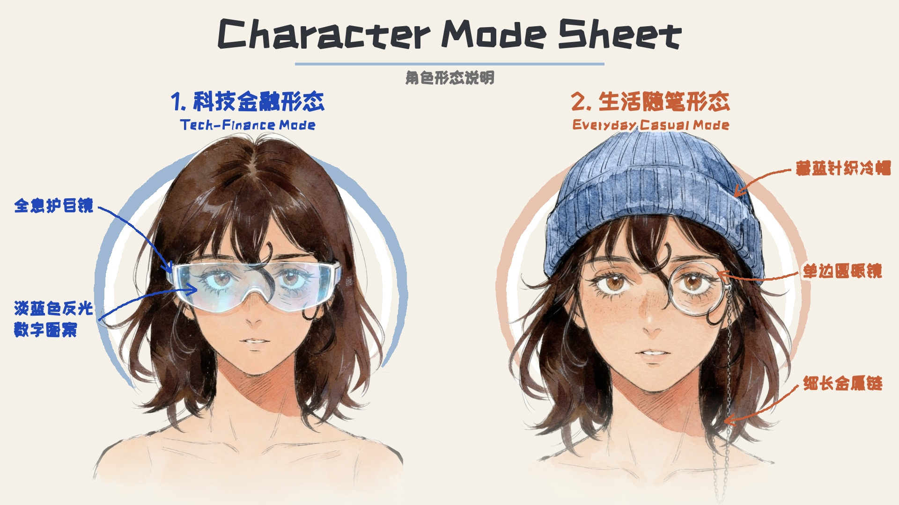
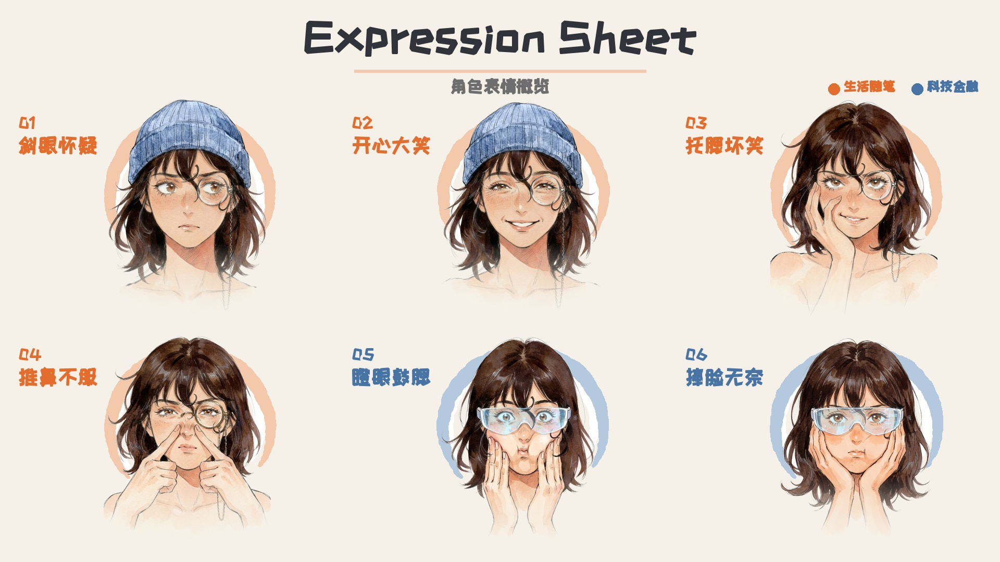
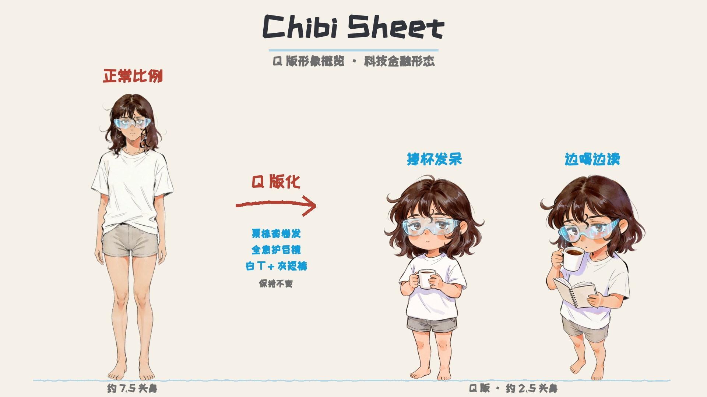
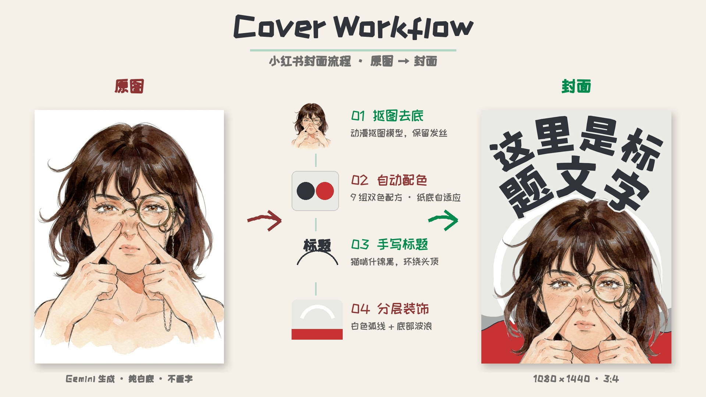
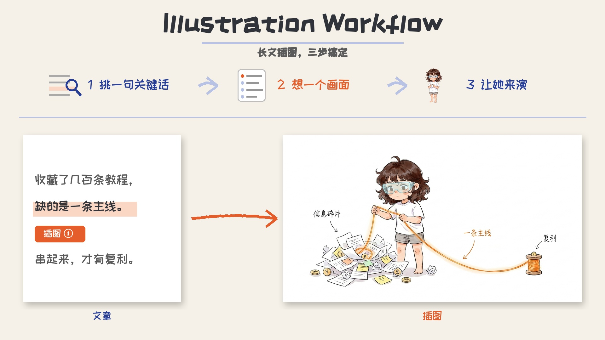

# Moolacat IP Kit

English · [中文](README.md)

> A small toolkit that keeps one hand-drawn personal IP, **moolacat**, consistent across RedNote (Xiaohongshu) covers, article illustrations and character sheets.

<p align="center">
  
</p>

## What it solves

The two hardest parts of AI image generation for a personal brand are **the character looking different every time** and **Chinese titles coming out with typos**. This repo handles them this way:

- **Consistent character**: a fixed prompt plus reference images with separate roles. The identity image controls the face; style anchors control line and color. Only the scene changes from image to image.
- **Zero typos**: the image model never draws text. Chinese titles are set by a script in a handwritten font.
- **Consistent look**: 9 two-ink color recipes and adaptive paper backgrounds. Each cover picks one recipe automatically, so a series looks related because the rules are fixed, not by chance.

## The character: moolacat

The art style is late-80s / early-90s Japanese youth manga, ink lines with watercolor. She has chestnut, shoulder-length wavy hair with one curl over the forehead. She has two modes plus a chibi version:

| Mode | Signature | Used for |
|---|---|---|
| Tech-Finance `tech` | Translucent holographic goggles with a pale-blue sheen | Web3, AI, finance |
| Everyday `life` | Monocle (right side of the image) on a long thin chain; usually a knit beanie `#6B82A6` | Life, travel, essays |
| Chibi `chibi-*` / Illustration `illus-*` | ~2.5 heads tall, same accessories | Article illustrations, casual scenes |

### Expressions

<p align="center">
  
</p>

### Chibi

<p align="center">
  
</p>

## What it makes

### RedNote covers (3:4)

<p align="center">
  
</p>

### Article illustrations (16:9, or 3:4 for RedNote)

Each article gets only 1–2 illustrations, placed where the argument turns. Chibi moolacat performs the core action in each one. The method is adapted from [ian-xiaohei-illustrations](https://github.com/helloianneo/ian-xiaohei-illustrations); see [`illustration/GUIDE.md`](illustration/GUIDE.md).

<p align="center">
  
</p>

## Quick start

```bash
git clone https://github.com/yuumuujii/moolacat-ip-kit.git
cd moolacat-ip-kit
python3 -m venv .venv && .venv/bin/pip install -r requirements.txt
```

Image generation needs one of the following in a root `.env` file (`.env` is git-ignored):

- **Vertex AI**: `GOOGLE_CLOUD_PROJECT=<project id>`, then run `gcloud auth application-default login` once
- **AI Studio**: `GEMINI_API_KEY=<key>`

No API? `build_prompt.py` prints the full prompt and the reference-image order, so you can generate by hand in any web tool.

## Commands

```bash
# 1. Character images: tech / life / chibi-tech / chibi-life; -n = count; --no-beanie for life mode
.venv/bin/python scripts/gen_image.py life "Front-facing close-up, gentle smile, hand on cheek." -n 2

# 2. Normalize the beanie color to #6B82A6
.venv/bin/python scripts/recolor_beanie.py outputs/images/xxx.png

# 3. Cover layout: text before the space = main title, after = subtitle; colors are automatic
.venv/bin/python scripts/compose_cover.py outputs/images/xxx.png outputs/covers/cover.jpg --title "主标题 副标题"
.venv/bin/python scripts/compose_cover.py outputs/images/xxx.png outputs/covers/cover.jpg --title "主标题 副标题" --layout side

# 4. Illustrations: 16:9 for articles, 3:4 for RedNote
.venv/bin/python scripts/gen_image.py illus-tech "<SCENE>" --aspect 16:9 -n 2
.venv/bin/python scripts/gen_image.py illus-tech "<SCENE>" --aspect 3:4 -n 2

# Prompt only, plus the reference-image order
.venv/bin/python scripts/build_prompt.py tech "Eyes wide in surprise, hand on cheek."
```

Full prompt templates: [`docs/prompts/`](docs/prompts).

## Use your own character

The moolacat character and images are not licensed for reuse, but the whole method is. Copy `template/identity/`, fill in your character's description and reference images, and point `IP_IDENTITY_DIR` at it. The step-by-step guide is in **[docs/MAKE-YOUR-OWN.en.md](docs/MAKE-YOUR-OWN.en.md)**.

## Repository layout

```
identity/                 moolacat's identity (the single source of truth for generation)
├── prompt-base.txt       fixed prompt, only {{OUTFIT}} and {{SCENE}} change
├── chibi/prompt-base.txt chibi prompt
├── modes.json            6 modes: accessory text + reference order and roles
├── anchors.md            post-generation checklist (not sent to the model)
├── expressions/          approved expressions + reusable SCENE text
├── chibi-poses/          chibi poses
└── refs/                 identity-* (identity) · style/ (style anchors) · chibi-* · sources/
template/identity/        blank character template for your own IP
illustration/             article-illustration guide, prompt and examples
cover/                    colors.json (9 two-ink recipes) + fonts/
scripts/                  generation, recolor, cover layout, 5 overview sheets
docs/                     overview sheets, prompt templates, swatches, MAKE-YOUR-OWN guide
```

## Color: two-ink recipes

Adapted from [mono-color-skill](https://github.com/yanliudesign/mono-color-skill) and defined in `cover/colors.json`. The recipes apply to **cover text and decoration only**; the character keeps its watercolor colors.

| Swatch | Recipe | Hex (dominant + accent) | Default paper | Good for |
|---|---|---|---|---|
|  | Powder Blue + Signal Red | `#9EB8D3` + `#C83232` | Neutral White | Guides, dense info |
|  | Cobalt + Terracotta | `#2148B8` + `#C65F38` | Pale Beige | Life, travel |
|  | Botanical Green + Oxblood | `#008A4B` + `#8F3434` | Pale Beige | Books, nature |
|  | Charcoal + Signal Red | `#30343A` + `#C83232` | Cool Gray | Opinion, reviews, reports |
|  | Electric Blue + Carbon | `#173AE3` + `#242321` | Neutral White | Tech, high contrast |
|  | Mint Green + Charcoal | `#5EB783` + `#302D2E` | Neutral White | Essays, long reads |
|  | Ultramarine + Safety Orange | `#263E99` + `#E55D2B` | Cool Gray | Fintech, Web3, AI |
|  | Cyan + Brick Red | `#159DDA` + `#B64032` | Neutral White | Tools, products |
|  | Tangerine + Slate Blue | `#E46C2D` + `#4773A5` | Neutral White | Events, light topics |

| Swatch | Paper | Hex |
|---|---|---|
|  | Neutral White | `#FAFAF7` |
|  | Cool Gray | `#E9E9E5` |
|  | Pale Beige | `#F5F1E8` |

- Each cover uses exactly one recipe. The paper and the white swoosh do not count as inks.
- The dominant color covers about 70–85% (main title, back wave); the accent covers about 15–30% (subtitle, front wave).
- With light dominants (Powder Blue, Mint Green), the main title switches to the darker of the two colors.
- `--recipe auto` (the default) picks a recipe from the title, so the same title always gets the same colors. The paper follows the recipe; override it with `--substrate`.

## Fonts

| Font | Style | Used for | License |
|---|---|---|---|
| **Maoken Assorted Sans (猫啃什锦黑)** | Bold marker handwriting | Cover titles (default) | SIL OFL 1.1 |
| **ZCOOL KuaiLe (站酷快乐体)** | Thin marker, stroke-bolded by script | Overview sheets; fallback glyphs | SIL OFL 1.1 |
| PF Pinfan Hutu (PF频凡胡涂体) | Rough scribble | Optional cover font `--font pf-hutu` | Original license unverified; **not distributed**. Add it to `cover/fonts/` yourself |

## License

- **Code** (`scripts/`, config and prompt text): [MIT](LICENSE)
- **The moolacat character and all images**: all rights reserved; see [ASSET-LICENSE.md](ASSET-LICENSE.md). To use the method with your own character, follow [MAKE-YOUR-OWN](docs/MAKE-YOUR-OWN.en.md).
- Font and project credits: [NOTICE.md](NOTICE.md)

## Acknowledgements

This project builds on the following open-source work. Thank you to the authors for sharing it:

| Project | What was borrowed |
|---|---|
| [helloianneo/ian-xiaohei-illustrations](https://github.com/helloianneo/ian-xiaohei-illustrations) | The illustration method: illustrate only at cognitive anchors, the character performs the core action, three-step metaphor invention, QA checklist (MIT) |
| [yanliudesign/mono-color-skill](https://github.com/yanliudesign/mono-color-skill) | 9 two-ink recipes and adaptive paper; the "one focal point + thumbnail check" approach to covers |
| [bozhouDev/personal-ip-scenes](https://github.com/bozhouDev/personal-ip-scenes) | Swapping a fixed mascot for a personal IP; identity-drift checks |
| [Skr-ZERO/MaokenAssortedSans-TC](https://github.com/Skr-ZERO/MaokenAssortedSans-TC) | Maoken Assorted Sans font (SIL OFL 1.1) |
| [ZCOOL KuaiLe](https://fonts.google.com/specimen/ZCOOL+KuaiLe) | ZCOOL KuaiLe font (SIL OFL 1.1) |

## Roadmap

- [ ] Turn the writing workflow (long article → RedNote post → cover copy) into a `SKILL.md`
- [ ] Refresh style anchors with new favorite images
- [ ] Higher-resolution identity image for tech mode

---

Made by **moolacat** (RedNote / X nickname) · GitHub [@yuumuujii](https://github.com/yuumuujii) · X/Twitter [@yuumuujii](https://x.com/yuumuujii)
